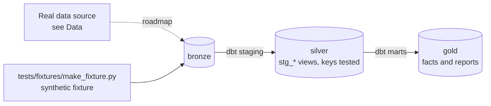

# Card Transactions & Fraud Analytics Mart

[](https://github.com/Saigwe/fraud-analytics-mart/actions/workflows/ci.yml)

> Continuous-audit controls and fraud analytics on card transactions: duplicate payments, out-of-hours activity and Benford's-law tests as dbt models, an exceptions workflow, and an ML score compared with the rules, under Slim CI.

**Author:** Stanley Igwe, Lead Data (Analytics) Engineer · [Portfolio](https://saigwe.github.io)
**Stack:** dbt Core (snapshots, unit tests, contracts) · Great Expectations · DuckDB, then Snowflake or BigQuery · scikit-learn · GitHub Actions (Slim CI)
**Status:** 🚧 Scaffolded. Fixture pipeline passes: `dbt build` 15/15. See [Roadmap](#roadmap).

Project 14 of my portfolio plan. At a Big Four firm I built internal-audit analytics for tier-1 banks; earlier, at a payments company, I worked on transaction data. This mart rebuilds those controls on public synthetic data. This repo rebuilds the problem on public and synthetic data. No employer or client data, code or logic is used.

---

## 90-second summary
| | |
|---|---|
| **Problem** | TODO: one sentence on the business problem. |
| **What I built** | TODO: fill in as the roadmap lands. |
| **Why it matters** | TODO: the decision this enables, in the user's words. |
| **Proof** | TODO: link to [Numbers](#numbers), with every claim reproducible. |

## Architecture


## Data
Real data: [PaySim](https://www.kaggle.com/datasets/ealaxi/paysim1) synthetic mobile-money transactions (6M+ rows). CI uses a synthetic card-transaction fixture with planted duplicate payments as an answer key.

| Bronze table (fixture) | Rows |
|---|---|
| `bronze.accounts` | 500 |
| `bronze.transactions` | 20,000 + 15 planted duplicates |

## Data model (gold layer, first cut)
| Model | Purpose |
|---|---|
| `rpt_duplicate_payments` | Control: the same account, amount and merchant category within duplicate_window_minutes. |
| `rpt_benford_first_digit` | Benford's law: observed vs expected share of each leading digit of transaction amounts. |

## Tests in place
- Staging: `unique` / `not_null` on every key, and `relationships` on every foreign key
- Marts: grain tests (`unique_combination`) and accepted values
- Business rules: `assert_planted_duplicates_detected`

## Numbers
*(Fill from real runs. Never estimate.)*
| Metric | Value |
|---|---|
| Rows processed (real data) | _tbd_ |
| dbt models / tests | _tbd_ |
| `dbt build` runtime | _tbd_ |

## How to run
Requires **Python 3.12** (what CI uses) and `make`, or run the commands in the `Makefile` by hand.
```bash
python -m venv .venv && source .venv/bin/activate   # Windows: .venv\Scripts\activate
pip install -r requirements.txt
make fixture-all   # synthetic fixture -> dbt build (used in CI)
```

## Roadmap
- [x] Scaffold: synthetic fixture, staging with key tests, first marts and business-rule tests, CI
- [ ] Load PaySim; keep the fixture for CI
- [ ] Controls as models: duplicate payments, split transactions under an approval limit, Benford first digit, out-of-hours activity, segregation-of-duties breaches
- [ ] Exceptions table with a status workflow (dbt snapshot for history)
- [ ] A simple ML fraud score next to the rules; compare precision and recall
- [ ] Data contracts on the gold models and Slim CI (`state:modified+`)
- [ ] Semantic layer for exception metrics
- [ ] Fill in [Numbers](#numbers) and the [design doc](docs/design_doc.md)
- [ ] 3-minute Loom walkthrough

## Interview topics this project prepares
- Rules vs ML for fraud
- Benford's law
- Data contracts
- Slim CI and deferral

## Data and licence
- **Fixture:** synthetic, generated with a fixed seed by `tests/fixtures/make_fixture.py` from `fixture_spec.yml`. It describes no real company or person.
- **Real data:** see [Data](#data) for each source's own licence and terms.
- **Code:** MIT (see `LICENSE`).
