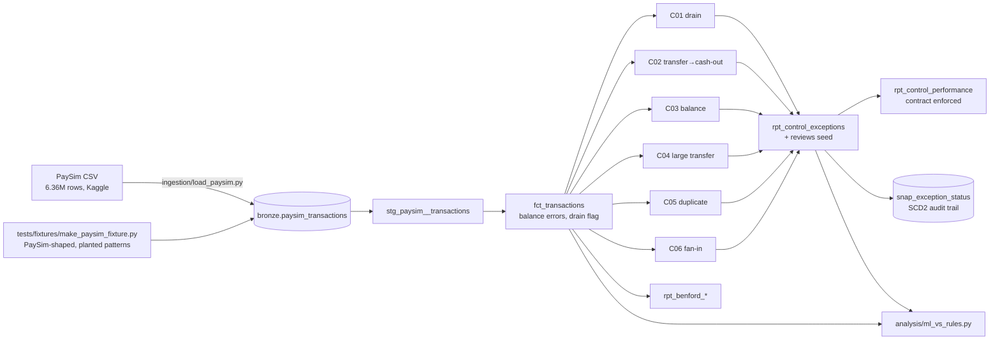

# Payments Fraud & Continuous-Audit Mart

[](https://github.com/Saigwe/fraud-analytics-mart/actions/workflows/ci.yml)

> Six continuous-audit controls as dbt models over 6.4M mobile-money transactions (PaySim). Each control is scored for precision and recall against the fraud label, the analysts get an exceptions queue with an audit trail, and a gradient-boosted model is compared with the rules on a later, unseen time window.

**Author:** Stanley Igwe, Lead Data (Analytics) Engineer · [Portfolio](https://saigwe.github.io)
**Stack:** Python · dbt Core (unit tests, contracts, snapshots, seeds) · DuckDB · scikit-learn · GitHub Actions
**Status:** Core pipeline complete and run on full PaySim (6,362,620 rows). Next on the [Roadmap](#roadmap): Slim CI and the semantic layer.

Project 14 of my portfolio plan. At a Big Four firm I built internal-audit analytics for tier-1 banks. This repo rebuilds that kind of control testing on public synthetic data; no employer or client data, code or logic is used.

---

## 90-second summary
| | |
|---|---|
| **Problem** | Fraud and audit teams run rules nobody measures. They can't say which controls catch fraud, which only make noise, or whether a model would do better with the same review capacity. |
| **What I built** | Six controls as dbt models, one exceptions table with severity and review status (and SCD2 history), a per-control precision and recall report, Benford's-law conformity, and a time-split model-vs-rules comparison. |
| **Why it matters** | Review capacity goes to the controls that find fraud. Noisy rules are visible and can be retired, and any model has to beat the rules on the same alert budget before it replaces them. |
| **Proof** | On 6.36M transactions, the two production controls catch **99.4% of fraud at 89.8% precision**. The simple threshold rule would raise 409k alerts at 0.7% precision. An answer key, unit tests and a contract back it up. See [Numbers](#numbers). |

## Architecture


## Controls
| ID | Control | Logic | Severity |
|---|---|---|---|
| C01 | Full balance drain | TRANSFER or CASH_OUT that empties the sender's account | high |
| C02 | Transfer → cash-out chain | TRANSFER and CASH_OUT of the identical amount in the same hour (mule pattern); both legs flagged | high |
| C03 | Sender balance inconsistency | funded sender whose balance change doesn't match the amount (ledger integrity) | medium |
| C04 | Large transfer | TRANSFER above 200,000 (the simple threshold rule) | medium |
| C05 | Duplicate payment | same sender, receiver, type and amount within 2 hours | medium |
| C06 | Fan-in | 4+ different senders transferring to one account in a day | high |

Thresholds are dbt vars, so a reviewer can change one and rebuild. The control catalogue is a seed. It holds each control's name, severity and owner, plus a **lifecycle** (production / review / retired) set from the measured results below, with the reason recorded beside it.

## Data model (gold layer)
| Model | Grain | Purpose |
|---|---|---|
| `fct_transactions` | one row per transaction | typed amounts, sender/receiver balance errors, drain flag, day and hour |
| `ctl_c01` … `ctl_c06` | one row per hit | each control's logic, isolated and unit-testable |
| `rpt_control_exceptions` | control × transaction | the analysts' queue: severity, evidence, review status |
| `snap_exception_status` | exception × status version | SCD2 history of review decisions (audit trail) |
| `rpt_control_performance` | one row per control | alerts, true positives, precision, recall; plus ANY_RULE and the incumbent `isFlaggedFraud` |
| `rpt_benford_first_digit` / `rpt_benford_conformity` | type × digit / type | Benford's-law test with Nigrini's MAD thresholds |

## Tests
- **Answer key (fixture only):** the fixture plants 40 mule chains, 10 duplicate payments and a fan-in account. `assert_planted_patterns_detected` fails if the control built for any of them misses it.
- **Unit tests:**
  - the chain control flags both legs of a same-hour, same-amount pair, and ignores a different hour, a different amount and other types
  - balance errors are zero for consistent rows and signed correctly for CASH_IN
- **Contract:** `rpt_control_performance` has enforced column names and types, so downstream dashboards can't break silently.
- **Business rules:**
  - true positives never exceed alerts
  - precision and recall stay in [0, 1]
  - every control that fires is reported
  - Benford shares sum to 1
- **Generic tests:** keys are unique and not null; control IDs exist in the catalogue; statuses come from an allowed list.

## Numbers
All figures are from real runs on a Windows laptop (DuckDB, dbt 1.11). Reproduce them with `make all`.

**Pipeline:** 6,362,620 transactions, 8,213 of them fraud. The load takes 8.3 s. `dbt build` passes 39/39 nodes in 9.7 s (about 30 s wall clock with dbt start-up). The snapshot holds 1.63M exception versions.

**Each control, measured against PaySim's fraud label (all 30 days):**

| Control | Lifecycle | Alerts | Fraud caught | Precision | Recall |
|---|---|---|---|---|---|
| C01 Full balance drain | production | 8,018 | 8,018 | 100% | 97.6% |
| C02 Transfer → cash-out chain | production | 9,083 | 8,153 | 89.8% | 99.3% |
| C03 Sender balance inconsistency | retired | 1,180,087 | 20 | 0.002% | 0.2% |
| C04 Large transfer (> 200k) | review | 409,110 | 2,740 | 0.7% | 33.4% |
| C05 Duplicate payment | review | 0 | 0 | n/a | 0% |
| C06 Fan-in (4+ senders a day) | review | 22,226 | 21 | 0.09% | 0.3% |
| **Production rules (C01 + C02)** | | **9,093** | **8,163** | **89.8%** | **99.4%** |
| All six controls | | 1,410,098 | 8,175 | 0.6% | 99.5% |
| Incumbent `isFlaggedFraud` | | 16 | 16 | 100% | 0.2% |

**What the numbers say:**
- **Two controls do almost all the work.** C01 and C02 find 99.4% of fraud with 9k alerts. All six together find only 12 more frauds, at the cost of 1.4M alerts.
- **C03 is retired as a fraud control.** It flags 1.18M transactions for 20 frauds. It still matters as a ledger-integrity check, but it belongs in finance reconciliation, not the fraud queue.
- **The incumbent rule is precise but blind.** It raises 16 alerts and misses 99.8% of fraud.
- **C05 never fires on PaySim** because sender ids never repeat. That's a limit of the simulator, so the control is kept for real ledgers.

**Model vs rules, on a later time window** (train on hours 1–500, test on 501+; TRANSFER and CASH_OUT; 124,630 test transactions, 2,652 of them fraud):

| Method | Alerts | Precision | Recall |
|---|---|---|---|
| Production rules (C01 + C02) | 2,640 | 100.0% | 99.5% |
| Gradient-boosted model, same alert budget | 2,640 | 99.9% | 99.4% |
| Gradient-boosted model, score ≥ 0.5 | 2,646 | 99.9% | 99.7% |
| All six controls | 72,390 | 3.6% | 99.6% |
| Incumbent `isFlaggedFraud` | 10 | 100.0% | 0.4% |

The model's average precision is 0.998. **On PaySim, two explainable rules match a gradient-boosted model**, so the model isn't worth its operational cost here.

There's a caveat, and it's an interview point. PaySim's fraud agent always drains the victim's account and cashes out at once, so this data separates fraud from non-fraud far more cleanly than real fraud would. The method carries over to real data; the near-perfect scores don't. ([results/ml_vs_rules.md](results/ml_vs_rules.md))

**Benford's law** (mean absolute deviation, graded with Nigrini's thresholds):

| Type | Transactions | MAD | Conformity |
|---|---|---|---|
| TRANSFER | 532,909 | 0.0054 | close conformity |
| PAYMENT | 2,151,388 | 0.0095 | acceptable |
| DEBIT | 41,430 | 0.0164 | nonconformity |
| CASH_OUT | 2,237,481 | 0.0222 | nonconformity |
| CASH_IN | 1,399,280 | 0.0228 | nonconformity |

Cash-in and cash-out amounts don't follow Benford. That's expected for simulated amounts drawn from fixed distributions, so the conformity test is a screening tool here, not proof of manipulation.

**CI fixture** (20,105 PaySim-shaped rows): `dbt build` passes 40/40, and all 51 planted patterns are found.

## How to run
Requires **Python 3.12** (what CI uses) and `make`, or run the commands in the `Makefile` by hand.
```bash
python -m venv .venv && source .venv/bin/activate   # Windows: .venv\Scripts\activate
pip install -r requirements.txt
make fixture-all   # PaySim-shaped fixture -> dbt build with answer-key tests -> model vs rules (CI)
```
Full data:
1. Download PaySim from [Kaggle](https://www.kaggle.com/datasets/ealaxi/paysim1). A free sign-in is needed.
2. Unzip it to `data/raw/paysim.csv`.
3. Run `make all`.

## Roadmap
- [x] PaySim loader, and a PaySim-shaped fixture with an answer key
- [x] Six controls, exceptions queue with review status and SCD2 snapshot, per-control precision/recall, Benford conformity
- [x] Unit tests, contract, answer-key and business-rule tests; time-split model vs rules
- [x] Full PaySim run (6.36M rows); controls given a lifecycle from measured precision and recall
- [ ] Retune C04 and C06 (thresholds, or combine with C01) and re-measure
- [ ] Slim CI: build only modified models and their children (`state:modified+`) against a stored production manifest
- [ ] Semantic layer for exception metrics (alerts, hit rate, time to review)
- [ ] Snowflake or BigQuery run, with runtime and cost
- [ ] Design doc and a 3-minute Loom walkthrough ([script ready](docs/walkthrough.md))

## Interview topics this project prepares
- Rules vs ML for fraud, and judging both at the same alert budget
- Precision, recall and the cost of false positives in an operations queue
- Benford's law and its limits
- Data contracts, unit tests and answer-key testing in dbt
- SCD2 snapshots for audit trails

## Data and licence
- **PaySim:** E. A. Lopez-Rojas, A. Elmir and S. Axelsson, "PaySim: A financial mobile money simulator for fraud detection", 28th European Modeling and Simulation Symposium (EMSS), 2016. It's a simulation built on aggregated real logs; no real customers. Check the licence on its [Kaggle page](https://www.kaggle.com/datasets/ealaxi/paysim1). The raw file is not committed (`data/` is gitignored).
- **Fixture:** synthetic, fixed seed. It describes no real company or person.
- **Code:** MIT (see `LICENSE`).
